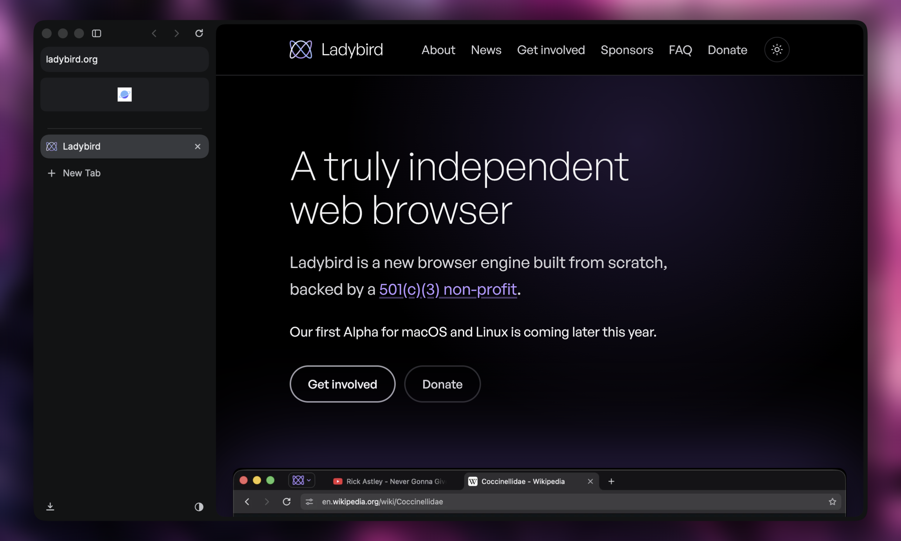

<div align="center">
  
  <h1>elaris</h1>
  <p><strong>A cross-platform browser written in Rust, powered by <a href="https://ladybird.org/">Ladybird</a>.</strong></p>
  <p>
    <a href="https://github.com/elarisbrowser/elaris/actions/workflows/ci.yml?query=branch%3Amain"></a>
    <a href="LICENSE"></a>
    
    
  </p>
</div>

<p align="center">
  
</p>

> **Pre-alpha.** Elaris is under active development. Expect rough edges and breaking changes.

## What Elaris does

Elaris pairs the Ladybird web engine with a Rust interface built on Rune. The browser is inspired by Arc, with vertical and horizontal tabs, live link previews (Peek), and Split View. It also has private windows, downloads, history, and session restore. macOS and Linux are the current development targets.

## Quick start from source

Install Git and Python 3.9 or newer, then clone the repository:

```sh
git clone https://github.com/elarisbrowser/elaris.git
cd elaris
```

**Work on the interface:** run `./elaris setup --ui --run`. This builds and opens the browser shell without Ladybird, so it cannot load websites. On macOS, install the Xcode Command Line Tools first. Homebrew and full Xcode are not needed for this route.

**Run the full browser:** run `./elaris setup --run`. This builds Ladybird on the first run. On macOS, install Homebrew and select Xcode 26 or newer first. On Linux, setup uses your system package manager and may need sudo. If your distro does not provide a recent Qt development kit, see the Docker option in [Development setup](SETUP.md#linux-in-docker).

After the first run, use `./elaris run --ui` for the shell or `./elaris run https://example.com` for the full browser.

## Find your guide

- **Test an alpha build:** [Install Elaris](docs/install.md) for supported hardware and package instructions.
- **Work on the code:** [Development setup](SETUP.md) for native and Docker paths, and [Contributing](CONTRIBUTING.md) for checks and PRs.
- **Understand the browser:** [Architecture](docs/architecture.md), [UI design](docs/ui-design.md), and the [documentation index](docs/README.md).
- **Package a build:** [Release procedure](docs/release.md).

[Report a bug or suggest a feature](https://github.com/elarisbrowser/elaris/issues). For a bug, include your OS, Elaris build, and steps to reproduce it.

## Support

If you find Elaris useful, you can support its development through [GitHub Sponsors](https://github.com/sponsors/elarisbrowser) or Ko-fi:

<a href='https://ko-fi.com/F8O123TMDU' target='_blank'></a>

## License

Elaris is licensed under [GPL-3.0-only](LICENSE). Contributions are welcome under the same license. See [TRADEMARKS.md](TRADEMARKS.md) for branding guidance.

## Star History

<a href="https://www.star-history.com/?repos=elarisbrowser%2Felaris&type=date&legend=top-left">
 <picture>
   <source media="(prefers-color-scheme: dark)" srcset="https://api.star-history.com/chart?repos=elarisbrowser/elaris&type=date&theme=dark&legend=top-left" />
   <source media="(prefers-color-scheme: light)" srcset="https://api.star-history.com/chart?repos=elarisbrowser/elaris&type=date&legend=top-left" />
   
 </picture>
</a>
