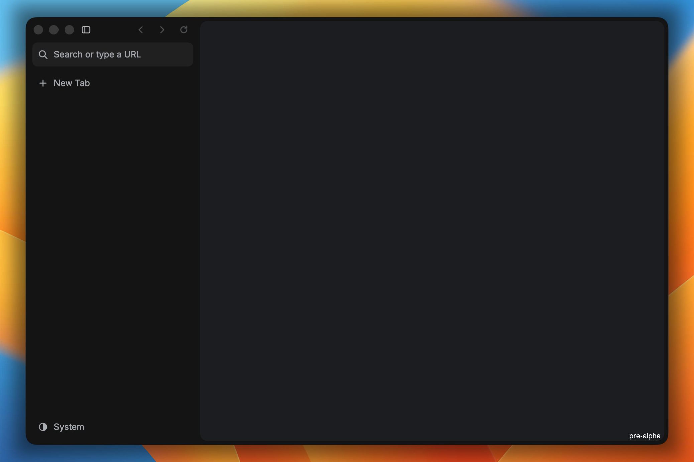

<div align="center">
  
  <h1>elaris</h1>
  <p>A cross-platform browser built with Rust and Rune, powered by Ladybird.</p>
  <p>
    <a href="https://github.com/elarisbrowser/elaris/actions/workflows/ci.yml?query=branch%3Amain">
      
    </a>
    <a href="LICENSE">
      
    </a>
    
  </p>
</div>

<p align="center">
  
</p>

## Quick start

You need Python 3.9+ and Git. macOS also needs [Homebrew](https://brew.sh/) and Xcode 26+. Linux setup supports apt, dnf, pacman, and zypper.

```sh
./elaris setup
./elaris build
./elaris run https://example.com
```

Setup installs system packages and Rust toolchains, then initializes Ladybird. Linux package installation may prompt for your password through `sudo`. The first engine build downloads and compiles dependencies, so it can take a while.

For shell-only work, use `./elaris run --ui`. See [Development setup](SETUP.md) for details.

On Linux, the browser toolbar slides down and pushes the page when the pointer reaches the top of
the app. Set `ELARIS_LINUX_TITLEBAR=always` to keep it visible.

## Development

Run `./elaris check` before opening a pull request. Use `./elaris format` to format Rust and bridge C++ code. Run `./elaris linux-build` to build in Docker and stream Linux build output in the terminal.

## Guides

- [Contributing](CONTRIBUTING.md)
- [Development setup](SETUP.md)
- [Architecture](docs/architecture.md)
- [Ladybird integration](docs/ladybird-embedding.md)
- [C++ bridge](bridge/README.md)

Licensed under [GPL-3.0-only](LICENSE). Contributions are welcome under the same license. See [Trademark policy](TRADEMARKS.md) for branding guidance.
